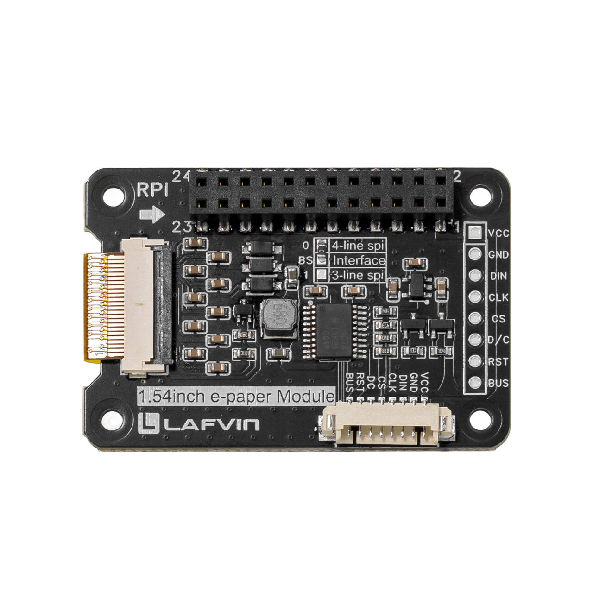
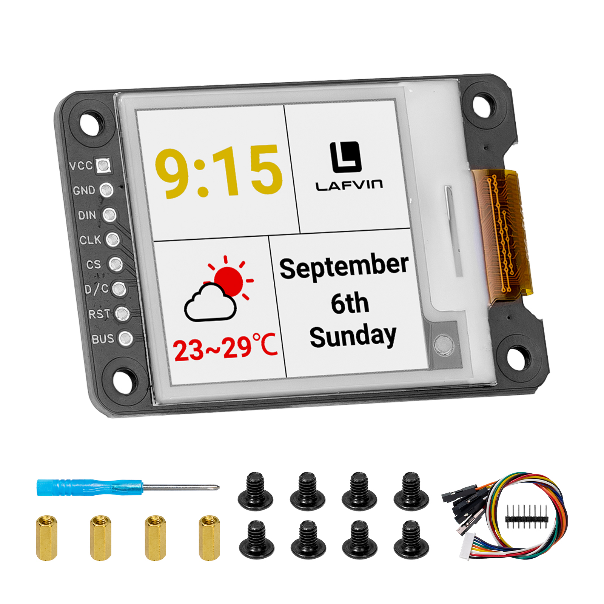
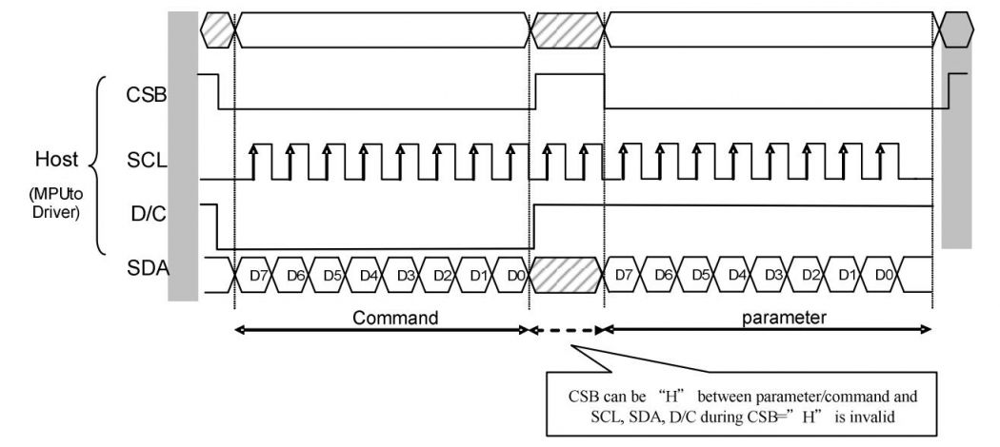

.. _about_this_kit:

About This Kit
====================

LAFVIN 1.54inch e-Paper Module
-------------------------------

.. container:: product-crop product-front

   .. image:: ./Product/img/正面.jpg
      :alt: Front view of the LAFVIN 1.54-inch four-colour e-paper module.

Introduction
---------------

The LAFVIN 1.54-inch e-paper module has a 200 x 200 four-colour display
(black, white, red, and yellow). Its 2 x 12-pin header connects to the first
24 pins of a Raspberry Pi GPIO header. The module communicates via SPI.

The reflective display has no backlight and retains its image after power is
removed. Power is mainly required when refreshing the display.

The 8-pin interface can also connect to controllers such as Arduino and ESP32.
The board includes voltage translation for 3.3 V and 5 V controllers.

Online development resources include pin definitions and Raspberry Pi examples.

Package Contents
----------------

.. list-table::
   :header-rows: 1
   :widths: 75 25
   :class: longtable

   * - Item
     - Quantity
   * - 1.54 inch E-paper Module
     - x1
   * - MX1.25 8-pin cable
     - x1
   * - Screwdriver
     - x1
   * - Screw kit
     - x1
   * - 8-pin header
     - x1

.. note::

   Raspberry Pi, ESP, Arduino, and other controller boards are not included.

Parameters
--------------

.. list-table::
   :header-rows: 1
   :widths: 40 60
   :class: longtable

   * - Parameter
     - Specification
   * - Model
     - GDEM0154F61H
   * - Screen size
     - 1.54 inch (nominal)
   * - Module footprint
     - 50.1 x 33.5 mm
   * - Display dimensions
     - 27 x 27 mm
   * - Operating voltage
     - 3.3 V or 5 V at the module VCC pin
   * - Communication interface
     - SPI
   * - Resolution
     - 200 x 200
   * - Display colour
     - Black, white, red, yellow
   * - Refresh time
     - Full: 20 s; fast: 12 s, at 23 deg C
   * - Operating temperature
     - 0 to 40 deg C
   * - Storage temperature
     - -25 to 70 deg C

.. container:: product-crop product-dimensions

   .. image:: ./Product/img/规格尺寸.jpg
      :alt: Module footprint of 50.1 by 33.5 millimetres and 27 by 27 millimetre active display area.

Communication Protocol
-----------------------

Note: For specific information about SPI communication, you can search for information online on your own.

Working Principle
--------------------

The e-paper used in this product uses "microcapsule electrophoresis display" technology for image display. The basic principle is that charged nanoparticles suspended in a liquid migrate under the action of an electric field. The e-paper display screen displays patterns by reflecting ambient light and does not require a backlight. Under ambient light, the e-paper display screen is clearly visible, with a viewing angle of almost 180°. Therefore, e-paper displays are ideal for reading.

Precautions
------------

.. role:: red
   :class: red

1. :red:`Partial Refresh Limitation: For e-Paper displays that support partial refresh, please note that you cannot refresh them with the partial refresh mode all the time. After refreshing partially several times, you need to fully refresh EPD once. Otherwise, the display effect will be abnormal, which cannot be repaired!`

2. :red:`Power Management: Note that the screen cannot be powered on for a long time. When the screen is not refreshed, please set the screen to sleep mode or power off it. Otherwise, the screen will remain in a high voltage state for a long time, which will damage the e-Paper and cannot be repaired!`

3. **Sleep Mode**: After the screen enters sleep mode, the sent image data will be ignored, and it can be refreshed normally only after initializing again.
      
4. **Image Display Issues**: If you find that the created image data is displayed incorrectly on the screen, it is recommended to check whether the image size setting is correct, change the width and height settings of the image and try again.

5. :red:`Cable Handling: The FPC cable of the screen is fragile, Please note: Do not bend the cable along the vertical direction of the screen to avoid tearing the cable; Do not repeatedly excessive bending line to avoid line fracture; Do not bend the cable toward the front of the screen to prevent the cable from being disconnected from the panel. It is recommended to use after fixing the cable during debugging and development.`

6. :red:`Screen Fragility: The screen of e-Paper is relatively fragile, please try to avoid dropping, bumping and pressing hard.`

7. **Testing Recommendation**: We recommend that customers use the sample program provided by us to test with the corresponding development board.

8. **Interface Selection**: Do not use different module interfaces at the same time.

9. **Optional Pin Header**: Soldering the reserved 8-pin header may interfere with the Raspberry Pi's physical layout. Solder it only when needed.

10. **Mounting Holes and Standoffs**: These are not designed specifically for a Raspberry Pi. They are provided for custom enclosures and for securing the module when connected by cables.

.. raw:: html

   
